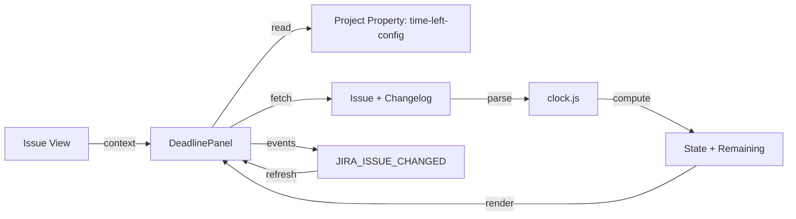

<div align="center">

# ⏳ Time Left

**Live SLA-like countdown to a Jira date field in the issue sidebar.**

Shows a real-time countdown to a configured deadline field (custom Date Time or system Due date) directly in the Jira issue view, with pause semantics inspired by JSM SLAs.


</div>

---

## 🎬 Demo

> **Screenshot placeholder** - The panel appears in the issue view sidebar showing the countdown, state badge, and progress bar. The time updates live (1s when < 1 day remaining, 30s otherwise).

---

## ✨ Why

Jira's native date fields show static values. Teams tracking SLAs or internal deadlines need a **live, at-a-glance indicator** that reflects actual time remaining, accounts for pauses, and updates automatically. Time Left provides this as a lightweight Forge app with **zero backend costs** and **no external dependencies**.

| | |
|---|---|
| 🎯 **Live countdown** | Updates in real-time with sub-second precision, adapts tick rate to remaining time |
| 📊 **Smart states** | On track, Due soon, Paused, Breached, Met, Missed, No deadline - with color-coded badges |
| ⏸️ **Pause semantics** | Time in configured pause statuses extends the effective deadline (like JSM SLAs) |
| 🪶 **Zero cost** | Pure frontend, no function modules, no storage, no egress - runs entirely on Atlassian |
| ⚡ **Lightweight** | Single static resource, two modules (panel + settings), ~840 kB bundle |
| 🎨 **Native look** | Atlaskit components with Atlassian design tokens (light/dark) |
| 🔒 **Per-project** | Configured via project settings, enabled/disabled independently per project |

---

## 🧭 How it works



1. **Panel initialization:** The `time-left-panel` Custom UI module loads in the issue sidebar, reads the project's `time-left-config` property
2. **Data fetch:** Fetches the issue with configured fields (`deadlineFieldId`, `startFieldId`, status, created, resolutiondate) and, if pause statuses are configured, the full changelog
3. **Clock computation:** Pure functions in `lib/clock.js` parse Jira dates, build a status timeline from changelog, calculate pause time, and compute the effective deadline and remaining time
4. **State determination:** Determines state (on-track, warning, paused, breached, met, missed) based on remaining time, pause status, and completion
5. **Live updates:** The `useTicker` hook drives re-computation every 1s (< 1 day remaining) or 30s (longer), pauses when the browser tab is hidden
6. **Event refresh:** Listens for `JIRA_ISSUE_CHANGED` bridge events to refetch after field edits

---

## 🗄️ Stored data

**Configuration is stored as a Jira project property, not in Forge storage.**

### Location
- Jira REST API: `POST /rest/api/3/project/{projectId}/properties/time-left-config`
- Readable/writable by users with `manage:jira-project` scope (Jira administrators)

### Structure

```json
{
  "version": 1,
  "enabled": true,
  "deadlineFieldId": "customfield_10234",
  "startFieldId": null,
  "warning": { "type": "hours", "value": 4 },
  "pauseStatusIds": ["10005", "10012"]
}
```

### Configuration fields

| Field | Type | Description |
|---|---|---|
| `version` | number | Config schema version (currently 1) |
| `enabled` | boolean | Whether the countdown panel is shown for this project |
| `deadlineFieldId` | string | Jira field ID for the deadline (custom Date Time or system Due date) |
| `startFieldId` | string\|null | Jira field ID for the clock start, or `null` for issue created, or `"none"` for deadline-only |
| `warning.type` | string | Threshold type: `"hours"` or `"percent"` |
| `warning.value` | number | Threshold value: hours remaining or percentage of total time |
| `pauseStatusIds` | string[] | Status IDs where the clock should pause |

> [!WARNING]
> Invalid or missing configuration means the app is "not configured" for that project. The panel remains hidden until valid config with `enabled: true` exists.

> [!NOTE]
> The display condition in `manifest.yml` uses `entityPropertyEqualTo` on `time-left-config.enabled == 'true'`, so the panel only appears in configured, enabled projects.

---

## 🔑 Scopes

The app requests only the permissions it needs to function:

| Scope | Why |
|---|---|
| `read:jira-work` | Read issues, changelogs, fields, statuses, and the project property configuration |
| `manage:jira-project` | Write the `time-left-config` project property (saving settings) |

> [!IMPORTANT]
> Adding or changing scopes requires `forge deploy` followed by `forge install --upgrade`.

---

## ⚙️ Configuration

Settings are managed in **Project settings → Time left** (visible only to Jira administrators due to the `hasGlobalPermission: ADMINISTER` display condition).

### Settings page options

| Option | Values | Default |
|---|---|---|
| **Enabled** | Toggle | `false` |
| **Deadline field** | Any Date or Date Time field | - |
| **Clock starts** | Issue created / None / Any Date or Date Time field | Issue created |
| **Due soon threshold** | Hours left or Percent of total time | 4 hours |
| **Pause statuses** | Any project statuses (multi-select) | Empty |

### Access control

- **Who can view:** Any user who can view the issue can see the countdown panel
- **Who can configure:** Only Jira administrators can access the settings page (manifest display condition)
- **Who can write config:** Users need `manage:jira-project` scope; Jira returns 403 if the user lacks permission, and the settings page shows a friendly message

> [!NOTE]
> This is a **UI restriction, not a security boundary**: a project admin can still write the `time-left-config` property via the Jira REST API directly. The panel only displays data the viewing user can already see in Jira.

---

## 🛠️ Development

### Prerequisites

- **Node.js:** 22.22.2 or later in the Node 22 release line (`.nvmrc` provided)
- **Forge CLI:** `npm install -g @forge/cli`
- **Jira Cloud:** A Jira Cloud site where you have administrator access

### Setup

```bash
# Use correct Node version
nvm install
nvm use

# Install Forge CLI and dependencies
npm install -g @forge/cli
cp manifest.yml.example manifest.yml   # manifest.yml is git-ignored
forge login                               # use your Atlassian developer account
forge register                            # interactive; writes app.id into manifest.yml
npm run setup
```

> [!NOTE]
> `manifest.yml` is **not tracked in git** because it contains the app registration (`app.id`). The repository ships `manifest.yml.example` with a placeholder `app.id` (`REPLACE_ME`); replace it by running `forge register`. Whenever you change `manifest.yml` (modules, scopes, permissions, resources), make the same change in `manifest.yml.example` (keeping `REPLACE_ME` instead of the real `app.id`).

### Build commands

```bash
npm run build             # vite build -> static/app/build
npm test                  # vitest (clock, config, format, panel refresh)
npm --prefix static/app exec vitest run src/lib/clock.test.js   # one file
npm --prefix static/app exec vitest run -t "breached"           # one test by name
npm run lint              # ESLint for static/app
npm run check             # rules, lint, tests, build and bundle size
```

### Deploy commands

```bash
# Development environment
forge deploy -e development
forge install -e development --site your-site.atlassian.net --product jira
forge tunnel              # local development with hot reload

# Production environment
forge deploy -e production
forge install -e production --site your-site.atlassian.net --product jira
```

> [!WARNING]
> Users can only grant the app consent in the `production` environment. In `development` and `staging`, only the app owner can use it.

<details>
<summary><b>Project layout</b></summary>

```text
.
├── .nvmrc                         # Node version (22)
├── LICENSE
├── PRIVACY.md                     # Privacy policy
├── AGENTS.md                      # Coding agent guidance
├── manifest.yml                   # Forge manifest (git-ignored)
├── manifest.yml.example           # Template for manifest.yml
├── package.json                   # Root package.json
├── static/
│   └── app/
│       ├── package.json           # App dependencies (React, Vite, Atlaskit)
│       ├── vite.config.js         # Vite configuration
│       ├── src/
│       │   ├── main.jsx           # Entry point, routes by moduleKey
│       │   ├── App.css            # Styles with design tokens
│       │   ├── lib/
│       │   │   ├── clock.js        # Pure core: parse, timeline, compute
│       │   │   ├── clock.test.js   # Unit tests for clock.js
│       │   │   ├── config.js       # Config validation + Jira project property I/O
│       │   │   ├── config.test.js  # Unit tests for config.js
│       │   │   ├── format.js       # Date/time formatting
│       │   │   ├── format.test.js  # Unit tests for format.js
│       │   │   └── jira.js          # requestJira wrapper + JiraError
│       │   ├── panel/
│       │   │   ├── DeadlinePanel.jsx   # Issue sidebar countdown panel
│       │   │   └── useTicker.js     # Tick hook (1s or 30s)
│       │   └── settings/
│       │       └── ProjectSettings.jsx  # Per-project settings page
│       └── index.html
└── build/                          # Vite build output (static/app/build)
```

</details>

---

## 🧪 Manual Test Plan

- [ ] **Create field:** Create a Date Time custom field "Deadline" and add it to a test project's screens
- [ ] **Configure:** In *Project settings → Time left*, enable the app, choose "Deadline", set threshold to 4 hours, and select a pause status like "Waiting for customer"
- [ ] **Check states:** Verify deadline in 2 days (On track), in 2 hours (Due soon), in the past (Breached), and empty (No deadline)
- [ ] **Test pauses:** Move the issue to the pause status, wait a minute (countdown must not change). Move it back: it should continue from the same value
- [ ] **Resolution:** Resolve the issue before and after the deadline to verify *Met* and *Missed* with correct "to spare"/"late" values
- [ ] **System field:** Switch the deadline field to the system *Due date* to check end-of-day behavior in your timezone
- [ ] **Unconfigured project:** Ensure the panel does not appear in a project without config
- [ ] **UI Edge cases:** Test in Dark mode and with a narrow browser window

---

## 📊 Clock States

The clock can be in one of seven states, determined by the `computeClock` function:

| State | Condition | Appearance |
|---|---|---|
| **on-track** | Remaining time > 0, not paused, not in warning | Green (success) |
| **warning** | Remaining time below threshold (hours or %) | Yellow/Orange (moved) |
| **paused** | Issue is in a configured pause status | Gray (default) |
| **breached** | Remaining time < 0 (overdue) | Red (removed) |
| **met** | Issue completed with remaining time ≥ 0 | Green (success) |
| **missed** | Issue completed with remaining time < 0 | Red (removed) |
| **no-deadline** | No deadline field configured or field is empty | Gray (default) |

> [!NOTE]
> *Breached* always wins over *paused*. If an issue is both paused and breached, it shows as Breached.

---

## ⚠️ Known Limitations

| Limitation | Description |
|---|---|
| **Visibility** | Shows only in the issue view sidebar. Lists and boards show the native Deadline field. |
| **JQL & Pauses** | The pause-extended effective deadline isn't stored anywhere, so JQL on the Deadline field doesn't account for pauses. |
| **Working hours** | No working-hours calendars in v1; the clock runs 24/7. |
| **Alerts** | Does not send notifications. Use Jira Automation (e.g., scheduled rule with `"Deadline" <= 2h AND statusCategory != Done`). |
| **Collapsed state** | The collapsed issue panel can't show a dynamic state lozenge (would require a function module). |
| **Date-only fields** | Fields like Due date default to end of day (23:59:59.999) in the user's timezone. |

---

## 🔮 Future Work

- 📅 **Working-hours calendars** - Pure math in `clock.js`, configurable per project
- 📊 **Dashboard gadget** - A `jira:dashboardGadget` listing nearest deadlines via JQL (frontend-only)
- 💾 **Store effective deadline** - In an issue property so JQL can use it (needs triggers/billed Forge Functions)
- 🌐 **Multiple timezones** - Support for teams across different timezones

---

## 📜 License

Code is under the [MIT License](LICENSE). Third-party dependencies retain their own licenses.

---

## 🔒 Privacy

See [PRIVACY.md](PRIVACY.md) for detailed data usage, config storage, and deletion policies.

---

*Last updated: 2025-01-15 | Status: Active development, private distribution*
